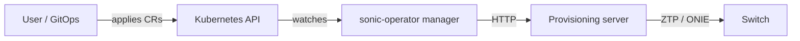

# Sonic Operator Architecture

`sonic-operator` is a Kubernetes operator that onboards and manages bare-metal network switches.

## Components

- **Controller manager** reconciles CRDs and maintains status.
- **Provisioning server** serves ZTP scripts and ONIE artifacts over HTTP.

## High-level flow

1. A `Switch` custom resource represents a physical switch and its endpoint.
2. The controller accepts the switch and marks it `Ready` for provisioning.
3. The provisioning server serves ZTP scripts and ONIE artifacts to the switch.

The former unauthenticated Sonic agent has been removed. The controller does not
connect to devices, discover interfaces, or enforce interface admin state.
`SwitchInterface` resources remain `Pending` until a supported backend is available.
Existing device status fields are retained but are no longer refreshed.

## Diagram

